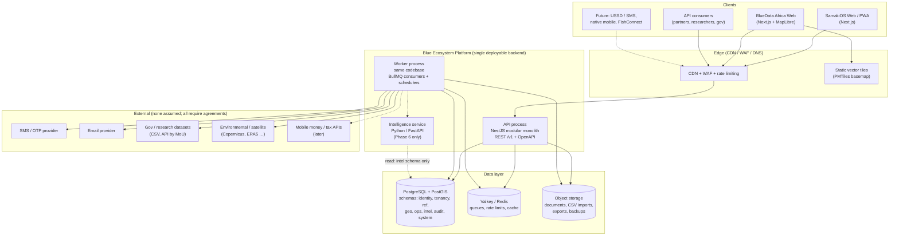
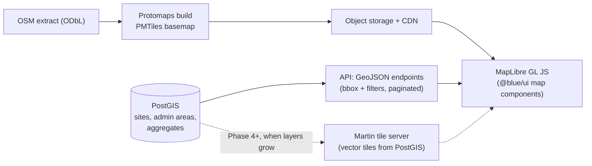
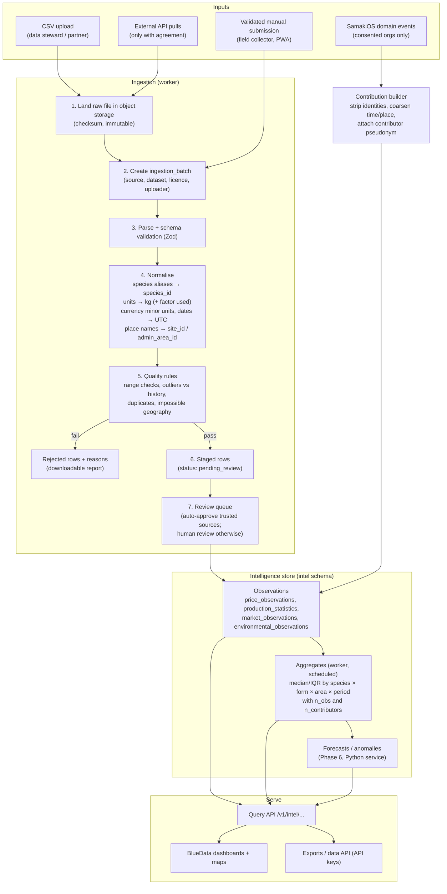
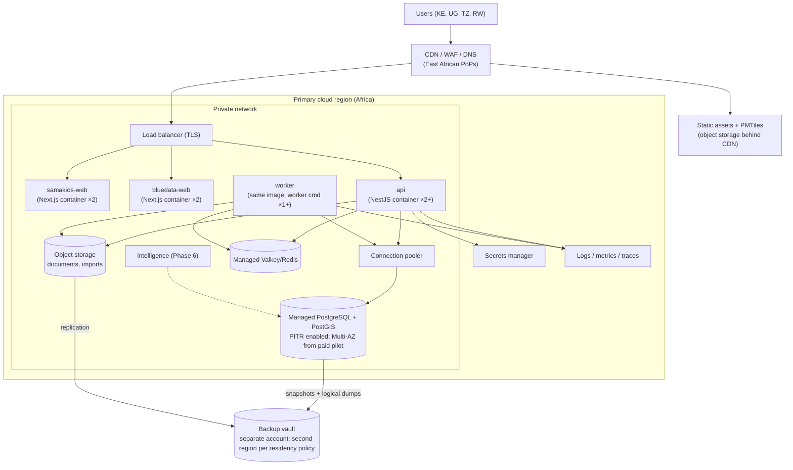

# Architecture — Blue Ecosystem Platform

> Status: **DRAFT v0.1 — Phase 1, awaiting founder review.** Nothing in this document is implemented yet.
> Owner: CTO / Principal Architect. Last updated: 2026-11-03.

Related documents: [DATABASE.md](DATABASE.md) · [API.md](API.md) · [DECISIONS.md](DECISIONS.md) · [DEVELOPMENT_ROADMAP.md](DEVELOPMENT_ROADMAP.md) · [PROJECT_STATUS.md](PROJECT_STATUS.md)

---

## Contents

1. [Analysis of the vision](#1-analysis-of-the-vision)
2. [Architectural challenges](#2-architectural-challenges)
3. [Missing requirements and open questions](#3-missing-requirements-and-open-questions)
4. [Recommended architecture](#4-recommended-architecture)
5. [Modular monolith vs microservices](#5-modular-monolith-vs-microservices)
6. [Technology stack evaluation](#6-technology-stack-evaluation)
7. [Monorepo structure](#7-monorepo-structure)
8. [Shared platform: how SamakiOS and BlueData share infrastructure](#8-shared-platform)
9. [Multi-tenancy and data isolation](#9-multi-tenancy-and-data-isolation)
10. [Identity, authentication and organisation access](#10-identity-authentication-and-organisation-access)
11. [GIS architecture](#11-gis-architecture)
12. [Data intelligence architecture](#12-data-intelligence-architecture)
13. [Operational → analytical integration](#13-operational--analytical-integration)
14. [Security architecture](#14-security-architecture)
15. [Deployment architecture](#15-deployment-architecture)
16. [Decisions: required now vs safely deferred](#16-decisions-required-now-vs-safely-deferred)
17. [Recommendation summary](#17-recommendation-summary)

---

## 1. Analysis of the vision

The company is really building **three things**, and the architecture must respect all three:

| Layer | What it is | Who pays | What makes it defensible |
|---|---|---|---|
| **Operational system** (SamakiOS) | Multi-tenant ERP for fisheries businesses | Traders, processors, cooperatives, farms (subscriptions) | Workflow fit for the local value chain (units, species, mobile money, landing-site reality) |
| **Intelligence layer** (BlueData Africa) | Curated, provenance-tracked fisheries data + GIS + analytics | Investors, processors, government, development orgs, researchers | Data that nobody else has, with traceable trust levels |
| **Platform** | Shared identity, organisations, permissions, billing, geography, reference data, audit, integration | — (enabler) | Speed of launching FishConnect / BlueTrace / BlueLogistics / AquaSense |

The key strategic insight: **SamakiOS is the data flywheel for BlueData**. Every SamakiOS purchase at a landing site is a price observation, a volume observation and a location observation. But that data is commercially sensitive and personal-data-bearing, so the flywheel only works if we get **consent, anonymisation and aggregation thresholds** right from day one. Getting this wrong is both a legal risk (Kenya DPA 2019 and peers) and an existential trust risk — traders will not use a system they believe leaks their prices to competitors.

The second insight: the users span from a **fisherman with a basic Android phone and intermittent 2G/3G at a beach** to an **export processor with an accounts team and EU auditors**. One UX cannot serve both; one *platform* can.

---

## 2. Architectural challenges

| # | Challenge | Why it is hard | Architectural response |
|---|---|---|---|
| C1 | **Connectivity at landing sites** | Purchases happen on the beach, often offline. Lost or duplicated records destroy trust in balances. | Offline-capable data-capture flows (PWA + local queue), **idempotency keys on every write**, client-generated UUIDv7 IDs, server-authoritative conflict rules. |
| C2 | **Units of measure are non-standard and species-specific** | Omena/dagaa/mukene sold by basin/tin; tilapia by piece or kg; Nile perch by kg and grade; fish maw by kg at export prices. A "basin" is not a fixed mass. | Store **original quantity + unit** *and* a **normalised kg value with the conversion factor used**. Conversion factors are data (per species/form/region), with provenance — never hardcoded. |
| C3 | **Naming is local** | Same species has different names per country/language (e.g. *Rastrineobola argentea*: omena (KE), mukene (UG), dagaa (TZ)). | Species keyed by scientific name; localised names as a separate table; search across all names. |
| C4 | **Product form drives price** | Fresh whole vs gutted vs fillet vs sun-dried vs smoked vs maw are different markets. | `species × product_form × grade/size` is the tradable item, not species alone. |
| C5 | **Cold-start data for BlueData** | Intelligence products need years of history; forecasts need ≥ 2 seasonal cycles. | Start structured **price collection immediately** (field enumerators + CSV) even before BlueData UI is polished; treat data collection as a product line, not a feature. |
| C6 | **Trust levels of data** | Official statistics, user submissions, estimates and model outputs will coexist and contradict each other. | Mandatory **provenance on every intelligence row** (`origin`, `verification_status`, `source_id`, `ingestion_batch_id`). Forecasts stored in a separate table — never mixed with observations. |
| C7 | **Tenant isolation vs cross-tenant aggregation** | BlueData needs SamakiOS data; tenants need guarantees it stays private. | Strict RLS on operational data; one-way, consent-gated, **k-anonymised** pipeline into intelligence schema via an outbox. BlueData never reads `ops` tables directly. |
| C8 | **Regulatory fragmentation** | Four data-protection regimes (KE, UG, TZ, RW), four tax e-invoicing regimes (KRA eTIMS, URA EFRIS, TRA EFD/VFD, RRA EBM), different currencies and minor units (UGX and RWF have 0 decimals). | Country is **configuration and reference data**, not code. Country-specific behaviour behind strategy interfaces (tax, invoice numbering, ID validation). |
| C9 | **Changing administrative boundaries** | Uganda creates districts frequently; Kenya's 2013 county transition. Historical statistics refer to old boundaries. | Admin areas are **versioned** (`valid_from`/`valid_to`) and hierarchical; statistics reference the boundary version they were reported against. |
| C10 | **Data residency** | Rwanda's law restricts storing personal data outside Rwanda without authorisation; Kenya restricts certain "strategic" processing to in-country; government buyers may demand local hosting. | Region-agnostic, containerised deployment that can be stood up as a separate **cell** per jurisdiction later. No global singletons that assume one region. |
| C11 | **Small team, serious scope** | Microservices, Kubernetes and a data lake would consume the team. | Modular monolith, managed services, one database, strict module boundaries enforced by tooling so we can split later. |
| C12 | **Geodata licensing** | Popular boundary datasets (e.g. GADM) prohibit commercial use without permission; OSM is share-alike (ODbL). | Every geographic layer carries licence metadata; prefer CC BY / public-domain sources for redistributed layers. |
| C13 | **Identity of real-world parties** | A fisherman can be a supplier in five traders' books *and* a platform user. Merging them automatically would leak relationships. | Per-tenant `trading_partners` records; optional, **mutually consented** link to a platform organisation/user. No global "fisherman registry" built from tenant data. |

---

## 3. Missing requirements and open questions

These need founder answers. Items marked **[BLOCKING]** change Phase 2/3 design.

### 3.1 Business

1. **[BLOCKING] Beachhead customer.** Who is the first *paying* SamakiOS customer — aggregators/traders at Lake Victoria landing sites, mid-size processors, or cooperatives/BMUs? The MVP workflow (and whether offline is day-one) depends on this. My assumption below: **aggregators/traders and small processors**, because they have the money, the pain (credit, margins, losses) and the transaction volume that feeds BlueData.
2. **[BLOCKING] Devices and connectivity.** What share of first users are on Android smartphones vs feature phones? Do we need offline capture in the MVP? (My recommendation: yes, for purchases/receipts only.)
3. **Pricing model.** Per organisation, per seat, per branch, transaction-volume tiers, freemium? How do customers pay us — M-Pesa, MTN MoMo, card, bank? This determines the billing design but not the MVP.
4. **BlueData monetisation and access tiers.** What is public (free, SEO), what is registered-free, what is paid? Do SamakiOS subscribers get BlueData included?
5. **[BLOCKING for Phase 5] Data-contribution deal.** Do SamakiOS customers contribute anonymised data in exchange for intelligence (a "give-to-get" model)? Opt-in or opt-out (opt-in recommended under KE DPA)?
6. **Data stewardship.** Who verifies data for BlueData? Do we employ field enumerators at markets/landing sites? This is an operational function the software must support (assignments, collection forms, review queues).
7. **Cooperatives and BMUs.** Beach Management Units are central institutions at Lake Victoria landing sites. Should they be first-class organisation types with member registers and levy collection? (I have modelled them as an organisation type; levies deferred.)
8. **Credit/advances.** Traders commonly advance cash, nets or fuel to fishermen against future catch. Is tracking advances and recoveries in scope? (High value, small effort — I recommend MVP scope as a payment type with balance tracking.)
9. **Languages for MVP.** English + Swahili at minimum? Luganda, Kinyarwanda, French later?
10. **Export workflows.** Are exporters (Nile perch fillets, maw) early customers? They bring EU traceability and health-certificate requirements — that is BlueTrace territory and should not leak into the MVP.

### 3.2 Technical / compliance

11. **[BLOCKING] Data protection posture.** We must register as data controller/processor with ODPC (Kenya), PDPO (Uganda), PDPC (Tanzania), NCSA (Rwanda) as we enter each market. Need a legal opinion on: lawful basis for processing fishermen's personal data entered by traders (they are data subjects who never signed up); cross-border transfer; retention periods.
12. **Tax e-invoicing.** Are early customers VAT-registered (and therefore must use eTIMS/EFRIS/EFD)? Design for it now (immutable invoices, sequential numbering, external tax reference); integrate later.
13. **Statutory record retention** per country (tax records are commonly 5–7 years — confirm per country). This overrides "right to erasure" for transactional data; we pseudonymise instead.
14. **SLA expectations.** Is 99.5% acceptable for MVP? It decides whether we pay for Multi-AZ from day one.
15. **Brand/domain names.** Needed before staging (cookies are scoped to a parent domain — see §10).
16. **Team size and timeline.** The roadmap assumes 2–3 full-stack engineers plus founder.

---

## 4. Recommended architecture

**One platform, one backend (modular monolith), one primary database (PostgreSQL + PostGIS), two product frontends, a background worker from the same codebase, and — only in Phase 6 — a Python intelligence service.**

### 4.1 Overall system architecture



### 4.2 System boundaries

| Inside our system | Outside (integrations behind adapters) |
|---|---|
| Identity, sessions, organisations, RBAC, entitlements | SMS / email / push delivery |
| SamakiOS operational records | Mobile-money rails (record-only in MVP) |
| BlueData intelligence store, provenance, aggregates | Tax authority e-invoicing |
| Reference data: species, units, currencies, admin areas | Government and research datasets |
| Geographic registry of sites (landing sites, markets, farms…) | Basemap source data (OSM), satellite/weather |
| Audit log, documents, notifications, outbox | LLM providers (Phase 6) |

Every external dependency sits behind a **port/adapter interface** inside the `integration` module so it can be swapped, mocked in tests and disabled per country.

### 4.3 Application architecture (inside the monolith)

```mermaid
flowchart LR
    subgraph HTTP["HTTP layer"]
        CTRL["Controllers<br/>/v1/..."]
        GUARD["Guards: Session/API-key auth →<br/>Tenant context → Permission → Entitlement"]
        PIPE["Zod validation pipes"]
    end

    subgraph PlatformMods["Platform modules"]
        IDN["identity"]
        TEN["tenancy<br/>(orgs, branches, members, roles)"]
        BIL["billing<br/>(plans, subscriptions, entitlements)"]
        REF["reference-data<br/>(species, units, currencies, countries)"]
        GEO["geo<br/>(admin areas, water bodies, sites, layers)"]
        DOC["documents"]
        NOT["notifications"]
        AUD["audit"]
        INT["integration<br/>(adapters, imports)"]
    end

    subgraph Samaki["SamakiOS modules"]
        PAR["partners<br/>(suppliers, buyers, transporters)"]
        SUP["supply<br/>(availability, catch, harvest)"]
        TRD["trading<br/>(purchases, sales, quotes, invoices)"]
        INV["inventory<br/>(batches, movements, losses)"]
        LOG["logistics<br/>(vehicles, consignments, deliveries)"]
        FIN["finance<br/>(payments, expenses, P&L)"]
        RPT["reporting"]
    end

    subgraph BlueData["BlueData modules"]
        SRC["sources<br/>(data sources, datasets, licences)"]
        ING["ingestion<br/>(CSV, validation, review)"]
        PRC["prices"]
        PRD["production"]
        AQU["aquaculture-intel"]
        ANA["analytics<br/>(aggregates, indicators)"]
        FC["forecasts (read; Phase 6)"]
    end

    subgraph Infra["Shared kernel"]
        DB["db (Drizzle, tx + RLS context)"]
        OUT["outbox / domain events"]
        Q["queue (BullMQ)"]
        LOGR["logger (pino + OTel)"]
    end

    CTRL --> GUARD --> PIPE
    PIPE --> PlatformMods
    PIPE --> Samaki
    PIPE --> BlueData
    Samaki -->|public module APIs only| PlatformMods
    BlueData -->|public module APIs only| PlatformMods
    Samaki -->|domain events| OUT
    OUT --> Q
    Q -->|consent-gated contribution| ANA
    PlatformMods --> Infra
    Samaki --> Infra
    BlueData --> Infra
```



**Module rules (enforced by lint rules / dependency-cruiser in CI):**

1. A module exposes a single public interface (`index.ts` exporting a service facade and DTO types). Other modules may not import its internals or touch its tables.
2. **SamakiOS modules must never import BlueData modules, and vice versa.** They communicate only via platform services and domain events. This is what keeps the products separable — and is the seam along which we could later extract a service.
3. Each module owns its tables (listed in [DATABASE.md](DATABASE.md)). Cross-module reads go through the owning module's service, or a read-only SQL view that the owning module publishes.
4. Business logic lives in the API. **Next.js server code is a thin presentation/BFF layer only** — no business rules, no direct DB access.

---

## 5. Modular monolith vs microservices

| Criterion | Modular monolith | Microservices |
|---|---|---|
| Team size fit (2–5 engineers) | ✅ One deployable, one pipeline | ❌ Ops overhead per service dominates |
| Transactional integrity (purchase → stock → balance → audit in one transaction) | ✅ Single ACID transaction | ❌ Sagas / eventual consistency for core ledger flows |
| Refactoring domain boundaries while we learn | ✅ Cheap — move code | ❌ Expensive — move APIs, data, contracts |
| Independent scaling | ⚠️ Scale whole process (API and worker scale separately already) | ✅ Per-service |
| Fault isolation | ⚠️ One bad module can hurt the process | ✅ Better isolation |
| Polyglot (Python ML) | ⚠️ Needs one exception | ✅ Natural |
| Cost | ✅ Few containers | ❌ More compute, networking, observability |
| Local development | ✅ `docker compose up` | ❌ Many moving parts |

**Recommendation: modular monolith**, with exactly two justified exceptions:

1. **Worker process** — same codebase, different entrypoint. Justification: imports, aggregation and notification fan-out must not compete with request latency. Not a separate service — a separate *process*.
2. **Python intelligence service (Phase 6)** — justification: the forecasting ecosystem (statsmodels, scikit-learn, LightGBM, Prophet-style libraries) is in Python, and model workloads have a different scaling and release profile. It reads only the `intel` schema (read-only DB role) and writes forecasts through the API or a dedicated table, never touching operational data.

**Triggers that would justify extracting a service later** (documented so we decide on evidence, not fashion):

- A module needs a different availability/SLA (e.g. public data API under heavy anonymous load).
- A module needs data residency different from the rest (country cell).
- A team boundary forms around it (≥ 2 engineers working only on it).
- Sustained resource profile that harms the rest (e.g. tile generation, GPS ingestion).

---

## 6. Technology stack evaluation

| Area | Proposed | Verdict | Notes / changes |
|---|---|---|---|
| Language | TypeScript | ✅ Keep | TS everywhere except Phase-6 Python service. `strict: true`, no `any` in domain code. |
| Frontend framework | React + Next.js | ✅ Keep, with constraints | App Router. SamakiOS is behind login → mostly client components + TanStack Query; BlueData uses server rendering for public/SEO pages. Next server must not hold business logic. |
| Styling | Tailwind CSS | ✅ Keep | Tailwind v4 with design tokens as CSS variables in a shared preset. |
| Component system | "consistent component system" | ✅ **Radix UI primitives + our own `@blue/ui`** (shadcn-style, owned code) | Owned components avoid a generic template look; Radix gives accessibility. Data grid: TanStack Table. Charts: a single library (recommend ECharts or Visx — decide in Phase 2 spike). |
| Offline | — (missing) | ➕ Add | PWA (service worker via Serwist), IndexedDB (Dexie) outbox for offline writes. Scope: purchase/receipt capture and partner lookup only. |
| i18n | — (missing) | ➕ Add | `next-intl`; ICU messages; locale on user profile. English + Swahili first. |
| Backend | Node.js + NestJS | ✅ Keep | NestJS gives module structure, DI, guards — matches the modular-monolith plan. Fastify adapter for performance. |
| API style | REST + OpenAPI | ✅ Keep | Zod schemas → OpenAPI 3.1 → generated typed client. No GraphQL now. |
| Validation | — | ➕ **Zod** in a shared `contracts` package | Same schemas validate on client and server; one source of truth for OpenAPI. |
| Database | PostgreSQL + PostGIS | ✅ Keep — strongly | PostgreSQL 17+ (18 where the managed provider offers it). PostGIS 3.5+. Extensions: `postgis`, `citext`, `pg_trgm` (fuzzy name search), `btree_gist` (exclusion constraints), `pgcrypto`. |
| ORM | Prisma | ⚠️ **Challenge → Drizzle ORM** (see ADR-005) | Our core needs — PostGIS columns and spatial SQL, RLS policies, partitioned tables, check/exclusion constraints, multiple Postgres schemas, `SET LOCAL` per transaction — are first-class or close to it in Drizzle and are workarounds in Prisma (`Unsupported(...)` columns, raw SQL for every spatial query, hand-edited migrations). |
| Queue | BullMQ | ✅ Keep | On **Valkey** (BSD-licensed Redis fork; managed offerings available) or Redis. |
| Cache | Redis | ✅ Keep (same instance) | Used for rate limiting, short-TTL caches of reference data/aggregates. Never the source of truth. |
| Scheduling | — | BullMQ repeatable jobs | Single scheduler definition in the worker; no cron on hosts. |
| GIS storage | PostGIS | ✅ | SRID 4326 storage; geography casts for distance; GiST indexes. |
| Map rendering | MapLibre GL JS | ✅ Keep | Open source, no per-load fees. |
| Basemap | OpenStreetMap | ✅ via **Protomaps PMTiles** on object storage/CDN | Single static file, no tile server for basemap, near-zero cost. ODbL attribution required. |
| Thematic tiles | — | Phase 4+: GeoJSON API first; **Martin** (PostGIS → vector tiles) when layers exceed a few thousand features | Avoid a tile server until needed. |
| AI / DS | Python, FastAPI, Pandas, scikit-learn | ✅ Phase 6 only | Use `uv` for environments; Polars acceptable instead of Pandas. Baselines first (seasonal naïve, ETS) before ML. |
| LLM | "LLM integrations" | ⏸️ Phase 6 | Natural-language analytics must be grounded in our query layer (text → validated query → results with citations), never free-form generation of figures. |
| Containers | Docker | ✅ | Multi-stage builds, distroless/alpine runtime images. |
| CI/CD | GitHub Actions | ✅ | Plus Renovate, CodeQL, gitleaks, osv-scanner. |
| Frontend hosting | Vercel | ⚠️ Acceptable, not default (see §15) | Recommend running Next.js as containers alongside the API in the same African region for latency, residency simplicity and a single bill. Vercel remains a valid option. |
| DB hosting | Managed PostgreSQL | ✅ Must support PostGIS, PITR, an African region | AWS RDS (af-south-1), Azure Database for PostgreSQL (South Africa North), GCP Cloud SQL (africa-south1). |
| Object storage | — | S3-compatible | Documents in the primary region; public basemap tiles can live on a zero-egress CDN storage (e.g. Cloudflare R2). |
| IaC | — | ➕ OpenTofu/Terraform | From the first staging environment. |
| Observability | — | ➕ OpenTelemetry + pino JSON logs + Sentry (errors) + Grafana stack or provider equivalent | |

---

## 7. Monorepo structure

### 7.1 Feedback on the proposed structure

The proposed tree is a good starting point. I recommend these changes:

| Proposed | Change | Reason |
|---|---|---|
| `apps/web/samakios`, `apps/web/bluedata` | **Flatten** to `apps/samakios-web`, `apps/bluedata-web` | Nested workspaces complicate pnpm/Turborepo globs and CI path filters for no benefit. |
| `apps/workers` (separate app) | **Second entrypoint inside `apps/api`** (`src/main.worker.ts`) | Workers execute the same module services (imports call `ingestion`, aggregation calls `analytics`). A separate app would either duplicate code or force us to move all modules into packages. Same image, different command. |
| `packages/authentication`, `packages/permissions` | **Fold into the API's `identity`/`tenancy` modules**; share only *permission keys and types* via `packages/contracts` | Auth is a server concern. Frontends need types + a client, not auth logic. Splitting security logic across packages increases the chance of inconsistent checks. |
| `packages/shared-types` + `packages/validation` | **Merge into `packages/contracts`** | With Zod, the schema *is* the type. Two packages would drift. |
| `packages/utilities` | **Replace with `packages/primitives`** (money, quantity/units, IDs, dates) | "utilities" becomes a junk drawer. Primitives are domain-meaningful and heavily tested. |
| `packages/database` | **Keep**, but importable only by `apps/api` (enforced) | Frontends must never get DB access. |
| — | **Add** `packages/api-client` (generated from OpenAPI), `packages/config` (tsconfig/eslint/tailwind preset), `packages/i18n` | |
| `services/intelligence` | **Keep, but do not create until Phase 6** | Avoid an empty Python project rotting. |
| `infrastructure/` | Rename `infra/`; add `infra/terraform` | IaC from first staging. |
| `docs/` | Keep; add `docs/adr/` later if DECISIONS.md gets long | |

### 7.2 Recommended structure

```text
blue-ecosystem/
├── apps/
│   ├── api/                      # NestJS modular monolith (API + worker entrypoints)
│   │   ├── src/
│   │   │   ├── main.api.ts
│   │   │   ├── main.worker.ts
│   │   │   ├── kernel/           # db context, outbox, queue, logging, errors, config
│   │   │   ├── platform/         # identity, tenancy, billing, reference-data, geo,
│   │   │   │                     # documents, notifications, audit, integration
│   │   │   ├── samakios/         # partners, supply, trading, inventory, logistics,
│   │   │   │                     # finance, reporting
│   │   │   └── bluedata/         # sources, ingestion, prices, production,
│   │   │                         # aquaculture-intel, analytics, forecasts
│   │   └── test/                 # integration tests (Testcontainers PostGIS)
│   ├── samakios-web/             # Next.js — operational product (PWA)
│   └── bluedata-web/             # Next.js — intelligence product (MapLibre)
├── packages/
│   ├── contracts/                # Zod schemas, DTO types, permission keys, error codes
│   ├── database/                 # Drizzle schema, SQL migrations, RLS policies, seeds
│   ├── primitives/               # Money, Quantity/UoM, UUIDv7, date/period helpers
│   ├── api-client/               # generated typed client + TanStack Query hooks
│   ├── ui/                       # design system (tokens, Radix-based components, charts, map)
│   ├── i18n/                     # message catalogues (en, sw, …)
│   └── config/                   # tsconfig, eslint, prettier, tailwind preset
├── services/
│   └── intelligence/             # Python/FastAPI (created in Phase 6)
├── infra/
│   ├── docker/                   # Dockerfiles, docker-compose for local dev
│   └── terraform/                # environments: staging, production
├── docs/
│   ├── ARCHITECTURE.md  DATABASE.md  API.md
│   ├── DECISIONS.md  DEVELOPMENT_ROADMAP.md  PROJECT_STATUS.md
├── .github/workflows/
├── pnpm-workspace.yaml
├── turbo.json
└── README.md
```

Tooling: **pnpm workspaces + Turborepo** (task caching, affected-only CI). Node.js LTS pinned via `.nvmrc`/`packageManager`.

---

## 8. Shared platform

### 8.1 What is shared vs product-specific

| Capability | Shared platform | SamakiOS-specific | BlueData-specific |
|---|---|---|---|
| Identity & sessions | ✅ One account, one login | | |
| Organisations, branches, memberships | ✅ | | |
| Roles & permissions | ✅ engine + permission registry | `samakios.*` permission keys | `bluedata.*` permission keys |
| Subscriptions & entitlements | ✅ one subscription per org per product | | |
| Reference data (species, forms, units, currencies, countries) | ✅ | | |
| Geography (admin areas, water bodies, sites registry) | ✅ | references sites (own warehouses = private sites) | maps and analyses sites |
| Documents, notifications, audit, outbox | ✅ | | |
| Design system | ✅ tokens + components | operational density theme | intelligence/map theme |
| Data | | `ops` schema (tenant-private) | `intel` schema (curated, provenance-tracked) |

### 8.2 Access rule

A user can perform an action if and only if **all** of the following are true:

```text
authenticated(user)
∧ active_membership(user, org)               -- tenancy
∧ org.entitled_to(product, feature)          -- subscription / plan
∧ role_permissions(user, org[, branch]) ∋ permission_key   -- RBAC
∧ (for data rows) RLS allows (org_id = current_org)         -- isolation
```

This gives "one account, many products": a processor's procurement officer can open BlueData's price dashboard with the same session, if the org's plan includes BlueData (or the free tier) and their role includes `bluedata.prices.read`. Their SamakiOS data is not visible in BlueData — only consented, aggregated contributions are.

### 8.3 Future products

FishConnect, BlueTrace, BlueLogistics, AquaSense become additional module groups (`apps/api/src/fishconnect/…`) plus a frontend app, registered as a new `product` row with their own permission keys and plans. Prepared seams now (cheap):

- `trading_partners.linked_organisation_id` (FishConnect: two tenants trading with each other).
- `batches` + `batch_lineage` (BlueTrace: provenance chains).
- `deliveries` + `delivery_events` with optional geometry (BlueLogistics: GPS).
- `production_units` / `environmental_observations` (AquaSense: sensor data).

We do **not** build these products' logic now.

---

## 9. Multi-tenancy and data isolation

### 9.1 Model

**Shared database, shared schema, `organisation_id` on every tenant-owned row, enforced by PostgreSQL Row-Level Security *and* the application layer.**

| Option | Isolation | Ops cost | Cross-tenant analytics | Verdict |
|---|---|---|---|---|
| Database per tenant | Highest | Very high (thousands of tenants) | Hard | ❌ |
| Schema per tenant | High | High (migrations × N) | Hard | ❌ |
| **Shared schema + RLS** | High when done properly | Low | Controlled via pipeline | ✅ |
| Shared schema, app-only filtering | Fragile (one missed `WHERE` leaks data) | Low | Easy (too easy) | ❌ |

Escape hatch: a large customer or government that requires physical isolation gets a **dedicated cell** (separate deployment of the same code + DB), not a different code path.

### 9.2 Enforcement layers

1. **Request context.** After authentication, the tenant guard resolves `orgId` from the URL (`/v1/orgs/{orgId}/…`), verifies active membership, and stores `{userId, orgId, membershipId, permissions}` in `AsyncLocalStorage`.
2. **Transaction context.** Every DB unit of work runs inside a transaction that begins with:

   ```sql
   SELECT set_config('app.org_id',  '<uuid>', true),   -- true = LOCAL to this transaction
          set_config('app.user_id', '<uuid>', true);
   ```

   `SET LOCAL` semantics make this safe with transaction-mode connection pooling (PgBouncer/RDS Proxy).
3. **RLS policies** on every `ops.*` table and on tenant-private rows in shared tables:

   ```sql
   ALTER TABLE ops.purchases ENABLE ROW LEVEL SECURITY;
   ALTER TABLE ops.purchases FORCE ROW LEVEL SECURITY;
   CREATE POLICY tenant_isolation ON ops.purchases
     USING      (organisation_id = current_setting('app.org_id', true)::uuid)
     WITH CHECK (organisation_id = current_setting('app.org_id', true)::uuid);
   ```

   If `app.org_id` is unset, `current_setting(..., true)` returns NULL and **no rows match** — fail closed.
4. **Database roles.** The runtime role (`app_runtime`) does not own tables and has no `BYPASSRLS`. Migrations run as `app_migrator`. Cross-tenant jobs (the contribution pipeline) run as a narrowly-privileged `app_pipeline` role that can read only the outbox and write only `intel` tables.
5. **Composite foreign keys** include `organisation_id` (e.g. `purchase_lines (organisation_id, purchase_id) → purchases (organisation_id, id)`) so a row physically cannot reference another tenant's parent.
6. **Tests.** A mandatory integration test suite creates two tenants and asserts that every repository method and every endpoint returns 404/empty for the other tenant's IDs. New tables without an RLS policy fail a CI check (query against `pg_class`/`pg_policies`).

### 9.3 Data sharing

Nothing crosses tenant boundaries implicitly. Sharing is explicit and recorded in `tenancy.data_sharing_agreements` (scope, granularity, consenting user, terms version, timestamps, revocation). Revocation stops future contributions; previously published aggregates remain (they are anonymised and non-attributable — this must be stated in the terms).

---

## 10. Identity, authentication and organisation access

### 10.1 Principles

- **Phone-first identity.** Many users have no email. A user has at least one verified identifier: E.164 phone or email.
- **Opaque server-side sessions**, not long-lived JWTs. Session token = 256-bit random, stored hashed (SHA-256) in `identity.sessions`; delivered as an `HttpOnly; Secure; SameSite=Lax` cookie scoped to the platform parent domain (single sign-on across `samakios.` and `bluedata.` subdomains). Revocation is immediate.
- **Passwords** hashed with Argon2id; **OTP** (SMS) for phone login and verification, rate-limited and attempt-capped; **TOTP MFA** required for org owners/admins and platform staff.
- **Machine access** via API keys (prefix + hashed secret, scoped, expiring) tied to an organisation.
- **Library:** evaluate Better Auth (TypeScript, self-hosted, supports organisations, phone OTP, 2FA, API keys) in a Phase 2 spike; fallback is a small in-house implementation on vetted primitives. Hosted IdPs (Auth0, Clerk) are rejected for now: per-MAU pricing is hostile to thousands of low-revenue users, and identity data residency becomes a third-party problem (ADR-007).

### 10.2 Authentication and organisation access flow

```mermaid
sequenceDiagram
    autonumber
    actor U as User
    participant W as SamakiOS / BlueData web
    participant A as API (identity + tenancy)
    participant R as Valkey (rate limit)
    participant DB as PostgreSQL
    participant S as SMS provider

    U->>W: Enter phone number
    W->>A: POST /v1/auth/otp/request {phone}
    A->>R: check rate limit (ip, phone)
    A->>DB: insert otp_challenge (hashed code, expiry, attempts=0)
    A-->>S: enqueue SMS (via worker)
    S-->>U: SMS code
    U->>W: Enter code
    W->>A: POST /v1/auth/otp/verify {challengeId, code}
    A->>DB: verify hash, attempts, expiry; upsert user; create session (hashed token)
    A-->>W: Set-Cookie: session (HttpOnly, Secure, SameSite=Lax, Domain=.platform)
    W->>A: GET /v1/me
    A->>DB: user + memberships + roles + org entitlements
    A-->>W: {user, organisations:[{id, name, roles, products}]}
    U->>W: Choose organisation
    W->>A: GET /v1/orgs/{orgId}/dashboard
    Note over A: Guards: session valid → membership active →<br/>entitlement(product) → permission(key)
    A->>DB: BEGIN; set_config('app.org_id', orgId, true); query (RLS enforced); COMMIT
    A->>DB: audit_log (for writes)
    A-->>W: data scoped to orgId
```

### 10.3 Authorisation model

- **Permissions** are code-defined string keys: `samakios.purchases.create`, `samakios.inventory.adjust`, `bluedata.prices.submit`, `bluedata.ingestion.review`, `platform.members.invite`…
- **Roles** are named sets of permissions, per organisation. System role templates (Owner, Admin, Procurement Officer, Sales Officer, Storekeeper, Accountant, Viewer, Field Data Collector, Data Reviewer) are copied into each org; custom roles later.
- **Branch scoping**: a role assignment may be limited to a branch (`membership_roles.branch_id`), e.g. a storekeeper at the Kisumu cold store only.
- **Platform roles** (separate from org roles): `platform_admin`, `data_steward`, `support` — with support access being **time-boxed, reason-logged impersonation** that is visible to the tenant in their audit log.

---

## 11. GIS architecture

### 11.1 Geographic data model (summary — full detail in DATABASE.md)

| Entity | Geometry | Notes |
|---|---|---|
| `ref.admin_areas` | MultiPolygon, 4326 | Hierarchical (country → region/county/district → sub-unit), **versioned** with `valid_from`/`valid_to`, source + licence. |
| `geo.water_bodies` | MultiPolygon | Lakes (Victoria, Kyoga, Albert, Tanganyika…), rivers, reservoirs, marine zones (EEZ later). |
| `geo.sites` | Point | Unified registry of **landing sites, markets, processing facilities, cold stores, farms, ports, hatcheries, feed suppliers**; type-specific detail tables. Public (registry) or private (owned by an org, RLS-protected). |
| `geo.fishing_grounds` | Polygon | Optional; coarse and sensitive (fishers may not want exact grounds published). |
| `geo.layers` | metadata | Imported external layers (e.g. protected areas, roads) — stored in PostGIS or as PMTiles in object storage. |
| Delivery routes | LineString | Optional on deliveries; GPS tracks later in partitioned table. |

**Conventions:** store `geometry(…, 4326)`; compute distances with `::geography` or project to an appropriate equal-area CRS for area statistics; GiST index on every geometry; precompute `admin_area_id` on points at write time (point-in-polygon in a trigger or service) so analytics groups by ID, not by repeated spatial joins.

**Privacy rule for coordinates:** individual fishers' and small farms' precise locations are personal data. Public BlueData maps show such points **snapped/aggregated** (e.g. to landing site or H3/hex grid) unless the owner consents to precise publication.

### 11.2 Map delivery pipeline



### 11.3 Spatial queries we must support (and how)

| Query | Implementation |
|---|---|
| Sites within bbox / admin area | `ST_Intersects` + GiST |
| Nearest markets to a landing site | KNN `ORDER BY geom <-> point LIMIT k` |
| Supply/price by admin area & period | Pre-aggregated by `admin_area_id` (no runtime joins) |
| Distance / transport cost estimates | `ST_Distance(geography)`; road-network routing deferred (OSRM later if needed) |
| Heat/hex maps | H3 indexes computed at ingestion (`h3` extension where available, else app-side) |

### 11.4 Candidate geographic data sources (none assumed — licence to be confirmed)

| Source | Content | Licence / access (verify before use) |
|---|---|---|
| OpenStreetMap | Basemap, roads, some landing sites/markets | ODbL — attribution; share-alike on derived *databases* |
| geoBoundaries | Admin boundaries | CC BY 4.0 (commercial use with attribution) |
| GADM | Admin boundaries | Non-commercial without permission — **avoid for commercial redistribution** |
| Natural Earth | Coarse boundaries, lakes | Public domain |
| National statistics bureaus (KNBS, UBOS, NBS-TZ, NISR) | Official boundaries, census | Varies; often requires request |
| Lake Victoria Fisheries Organization (LVFO) | Frame surveys (landing sites, boats, gear), catch assessment surveys | Requires institutional agreement |
| National fisheries research institutes (KMFRI, NaFIRRI, TAFIRI) | Research data, landing sites | MoU / data-sharing agreement |
| Copernicus (Sentinel, ERA5, land/lake services) | Satellite imagery, climate reanalysis, lake water quality products | Free & open including commercial use, with attribution (confirm per product) |
| Global Fishing Watch | Vessel activity (mostly marine, AIS) | Mostly CC BY-NC; low relevance to Lake Victoria |

---

## 12. Data intelligence architecture

### 12.1 Data classes (the six distinctions)

Every record in the platform belongs to exactly one storage class, and intelligence records additionally carry an origin and a verification status.

| Class | Where it lives | Visibility | Mutability |
|---|---|---|---|
| 1. Operational transactional | `ops.*` | Owning tenant only (RLS) | Documents immutable once confirmed; corrections by reversal |
| 2. Aggregated analytics | `intel.*_aggregates` | Per entitlement; published only above k-anonymity threshold | Recomputed; versioned by computation run |
| 3. External datasets | `intel.*` with `origin = external_dataset` / `official_statistic` | Per dataset licence | Append; revisions recorded as new versions with `supersedes_id` |
| 4. User-submitted | `intel.*` with `origin = user_submission` / `field_collection` | Per entitlement after review | Append-only; status transitions logged |
| 5. Verified | Not a separate table — `verification_status = verified` + `verified_by` + `verified_at` + method | | |
| 6. AI-generated | `intel.forecasts`, `intel.anomalies` only — **never** in observation tables | Always labelled with model, version, interval, inputs | Immutable per run |

The UI must render origin and verification visibly (badges, legends, tooltips), and every chart/table cites its sources. This is a product requirement, not decoration.

### 12.2 Ingestion and analytics pipeline



Key properties:

- **Idempotent and replayable.** Raw files are kept; a batch can be re-processed with improved normalisation rules (new `ingestion_batch` linked to the original).
- **Provenance is never lost.** Each observation references `source_id`, `ingestion_batch_id`, the raw row number, and the conversion factors applied.
- **No silent FX conversion.** Prices are stored in the observed currency; cross-currency comparisons convert at query time using `ref.fx_rates` with the rate source and date shown.

### 12.3 AI (Phase 6 preview, not built now)

- Start with **transparent baselines** (seasonal naïve, ETS/ARIMA per series) and only add ML when it beats them on back-tests.
- Every forecast stores: model id + version, training window, input series and their sources, point estimate, 80% and 95% intervals, back-test error metrics, generated_at.
- Natural-language analytics: LLM translates a question into a **constrained query over approved views**, executes it, and answers with the numbers *and* their sources. It may not produce numbers that did not come from a query.
- Readiness gate: a series is forecastable only with ≥ 24 months of reasonably dense observations (configurable), otherwise the UI says "insufficient data".

---

## 13. Operational → analytical integration

### 13.1 Mechanism: transactional outbox

1. When SamakiOS confirms a purchase (for example), the same DB transaction writes the purchase, inventory movement, audit entry **and** an `system.outbox_events` row (`purchase.confirmed`, payload with IDs and minimal facts).
2. The worker polls/claims outbox rows (`FOR UPDATE SKIP LOCKED`), publishes to BullMQ, marks them published. At-least-once delivery; consumers are idempotent on `event_id`.
3. The **contribution consumer** checks whether the org has an active `data_sharing_agreement` covering that scope. If not: drop. If yes: build an anonymised contribution — species, form, grade, unit price per kg, quantity bucket, landing site or admin area (never supplier identity), date (coarsened to day), contributor pseudonym (stable HMAC of org ID with a rotating secret, used only for counting distinct contributors).
4. Contributions land in `intel.price_observations` / `intel.market_observations` with `origin = platform_derived`.
5. **Aggregation jobs** compute published aggregates only where `n_distinct_contributors ≥ k` (start with k = 3, configurable per scope) **and** no single contributor exceeds a dominance threshold (e.g. 60% of volume). Cells that fail are suppressed or merged into a coarser geography/period.

### 13.2 Why not alternatives

| Alternative | Why not (now) |
|---|---|
| BlueData queries `ops` tables directly | Breaks tenant isolation and module boundaries; one bug leaks commercial data. |
| Logical replication / CDC (Debezium) into a warehouse | Operational overhead not justified at our scale; revisit when analytics volume demands a columnar store. |
| Nightly batch export | Loses event semantics and consent checks at event time; outbox gives both with low cost. |

### 13.3 Analytics storage evolution

- **Now:** `intel` schema in the same PostgreSQL; native range partitioning by month for observation tables; materialised aggregate tables refreshed by worker jobs.
- **Later (trigger: aggregate queries > seconds, or > ~100M observation rows):** add a columnar engine (ClickHouse, or DuckDB over Parquet in object storage) fed from the same outbox/aggregates. The API contract does not change.

---

## 14. Security architecture

| Area | Control |
|---|---|
| Baseline | Target **OWASP ASVS Level 2** for the platform; OWASP API Security Top 10 checklist per release. |
| Authentication | Argon2id; OTP limits (e.g. 5 attempts, 5-minute expiry, per-phone and per-IP throttles); TOTP MFA for owners/admins/platform staff; session rotation on privilege change; idle and absolute session timeouts. |
| Authorisation | Deny-by-default guards; permission check on every endpoint (CI test fails if an endpoint lacks a declared permission); RLS as second line. |
| Tenant isolation | §9 — RLS + composite FKs + cross-tenant test suite. |
| Input | Zod validation at the edge; strict body size limits; CSV import parsing in worker with row/size caps; file uploads type-sniffed, size-limited, stored outside web root with signed URLs; malware scanning before documents are shared. |
| Transport | TLS everywhere; HSTS; secure cookies; CSP on web apps. |
| CSRF | SameSite=Lax cookies + required custom header / CSRF token on state-changing requests from browsers. |
| Rate limiting | Edge (WAF) + application (Valkey-backed token buckets: per IP, per user, per org, per API key; stricter on auth and import endpoints). |
| Secrets | Cloud secrets manager; never in repo or images; `.env` only for local dev; gitleaks in CI; integration credentials stored as references (`secret_ref`), not plaintext columns. |
| Data protection | Data minimisation (no national ID numbers unless a feature needs them; if needed, encrypted at field level); purpose and consent records; DSAR export; erasure = pseudonymisation where statutory retention applies; retention schedules enforced by jobs; Data Protection Impact Assessment before Phase 3 pilot; registration with each country's regulator before processing there. |
| Logging | Structured JSON (pino) with request ID, user ID, org ID; **PII redaction** (phones, emails, tokens) in log serializers; logs retained 30–90 days; audit log separate and longer. |
| Audit | Append-only `audit.audit_log` (app role has INSERT only), monthly partitions, covering: auth events, membership/role changes, financial documents, stock adjustments/losses, data-sharing consents, exports, support impersonation. |
| Supply chain | Lockfile, Renovate, osv-scanner, CodeQL, pinned base images, SBOM on release. |
| Backups | §15.3. |
| Incident response | Runbook + breach-notification procedure (Kenya DPA requires notifying the Data Commissioner within 72 hours of becoming aware of a qualifying breach — confirm equivalents in UG/TZ/RW). |

---

## 15. Deployment architecture

### 15.1 Recommendation

Run everything in **one cloud region in Africa**, as containers on a managed container service, with managed PostgreSQL+PostGIS, managed Valkey/Redis and S3-compatible storage; put a CDN/WAF with East African points of presence in front.

Candidate primary regions: AWS **af-south-1** (Cape Town), Azure **South Africa North**, GCP **africa-south1** (Johannesburg). In-country Kenyan hosting (local data centres, or hyperscaler in-country regions as they become available) is the path for customers that require it — enabled by our containerised, region-agnostic design. **Decision needed:** provider choice (ADR-010 lists the trade-offs; I lean AWS for PostGIS-capable RDS, ECS Fargate simplicity and ecosystem maturity, but credits/partnerships may decide this).

### 15.2 Deployment diagram



### 15.3 Environments, CI/CD, backups

- **Environments:** `local` (docker compose: PostGIS, Valkey, Mailpit; a local S3 emulator is added with the documents module), `staging` (production-like, synthetic/anonymised data only), `production`. Optional preview deployments for frontends against staging API.
- **Pipeline (GitHub Actions):** lint → typecheck → unit tests → integration tests (Testcontainers PostGIS) → migration dry-run against a copy of staging schema → build images → deploy to staging automatically on `main` → **manual approval** to production. Migrations are forward-only, backwards-compatible (expand → migrate → contract).
- **Backups:** managed PITR (target **RPO ≤ 15 min**), daily snapshots retained 35 days, weekly logical dumps (`pg_dump`) retained 12 months in a separate account; object-storage versioning. **Quarterly restore drills** with a documented **RTO ≤ 4 h** (targets to be confirmed with business). Cross-region backup copy only where the residency policy permits (Rwanda personal data, for example, may need in-country backup storage).
- **Observability:** OpenTelemetry traces (API → DB → queue), RED metrics per endpoint, queue depth/age alerts, error tracking, uptime checks from East Africa, DB slow-query log.
- **Cost envelope (indicative, to validate):** a minimal production footprint (2 small API tasks, 1 worker, 2×2 web tasks, small managed Postgres single-AZ, small Valkey, storage, CDN) is typically in the low hundreds of USD per month; Multi-AZ roughly doubles the database line.

---

## 16. Decisions: required now vs safely deferred

### Must decide before Phase 2

| # | Decision | Recommendation | ADR |
|---|---|---|---|
| D1 | Architecture style | Modular monolith + worker process; Python service only in Phase 6 | ADR-001 |
| D2 | Monorepo tooling & layout | pnpm + Turborepo; layout in §7.2 | ADR-002 |
| D3 | Frontend split | Two Next.js apps sharing `@blue/ui`, `@blue/contracts`, `@blue/api-client` | ADR-003 |
| D4 | Tenancy model | Shared schema + RLS + composite FKs | ADR-004 |
| D5 | ORM / migrations | Drizzle ORM + SQL migrations (challenge to Prisma) | ADR-005 |
| D6 | IDs | UUIDv7 everywhere + human-readable per-org document numbers | ADR-006 |
| D7 | Authentication | Self-hosted, phone-first, opaque sessions; Better Auth spike | ADR-007 |
| D8 | Money & quantity representation | Integer minor units + ISO 4217; original qty/unit + normalised kg | ADR-008 |
| D9 | Offline scope for MVP | PWA offline for purchase/receipt capture only; idempotency keys on all writes | ADR-009 |
| D10 | Beachhead persona | Aggregators/traders + small processors (needs founder confirmation) | — |

### Decide before staging / pilot (Phase 2 end – Phase 3)

Cloud provider and region (ADR-010), brand domains, SMS provider, email provider, error-tracking/observability vendor, DPIA and regulator registration, MVP languages.

### Safely deferred

| Decision | Defer until | Why it's safe |
|---|---|---|
| Python forecasting libraries, LLM provider | Phase 6 | Isolated service; no data yet |
| Vector tile server (Martin) | Layers > a few thousand features | GeoJSON endpoints suffice; same data source |
| Columnar analytics store | Aggregate latency / volume triggers | API contract unchanged |
| Mobile-money API integration | Post-MVP | Payments recorded manually with references |
| Tax e-invoicing integration | First VAT-registered customer needs it | Invoice model already immutable/sequenced |
| USSD/SMS data capture | After smartphone MVP validated | Uses the same API/idempotency model |
| Native mobile app | If PWA proves insufficient | PWA + API-first keeps option open |
| Subscription payment provider | Before charging customers | Plans/entitlements modelled independently |
| Enterprise SSO (OIDC/SAML) | First enterprise/government request | Identity model supports external identities |
| Microservice extraction | Triggers in §5 | Module boundaries enforced from day one |
| Multi-region / country cells | Residency-bound contract | Region-agnostic deployment from day one |

---

## 17. Recommendation summary

**Recommended architecture:** a TypeScript **modular monolith** (NestJS on Fastify) with a co-deployed worker process, backed by **one PostgreSQL + PostGIS database** organised into ownership-based schemas (`identity`, `tenancy`, `ref`, `geo`, `ops`, `intel`, `audit`, `system`), with **row-level-security tenant isolation**, a **transactional outbox** feeding a **consent-gated, k-anonymised** intelligence store, two **Next.js** product frontends sharing a design system and generated API client, **MapLibre + PMTiles** for low-cost mapping, and a **Python intelligence service only once data justifies it**. Deployed as containers in an African cloud region behind a CDN/WAF, with IaC, PITR backups, and observability from the first staging environment.

**Why this fits an early-stage African startup with regional ambitions:**

1. **Small team leverage.** One deployable, one database, one language, managed services. The team spends time on fisheries workflows, not on distributed-systems plumbing.
2. **Correctness where money and trust live.** Purchases, stock, balances and audit commit in one ACID transaction; tenant isolation is enforced by the database, not by developer discipline.
3. **Cost discipline.** No per-MAU identity fees, no per-map-load fees, no idle microservices. Infra cost scales with revenue, not with user count.
4. **Built for the real field.** Phone-first identity, offline capture, local units and names, mobile-money references, multiple currencies with correct minor units.
5. **Trustworthy intelligence.** Provenance, verification and AI outputs are separated structurally, which is what investors, governments and researchers will require before relying on BlueData.
6. **Expansion without rewrites.** Countries are configuration; residency needs are met by deploying another cell of the same system; new products are new module groups on the same platform; services can be extracted along boundaries we already enforce.
