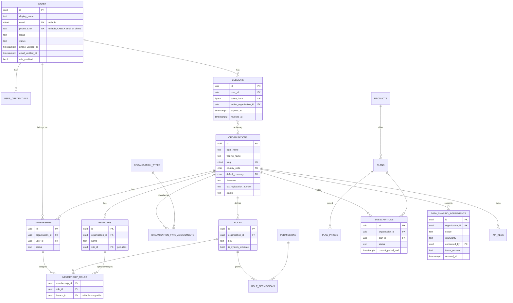
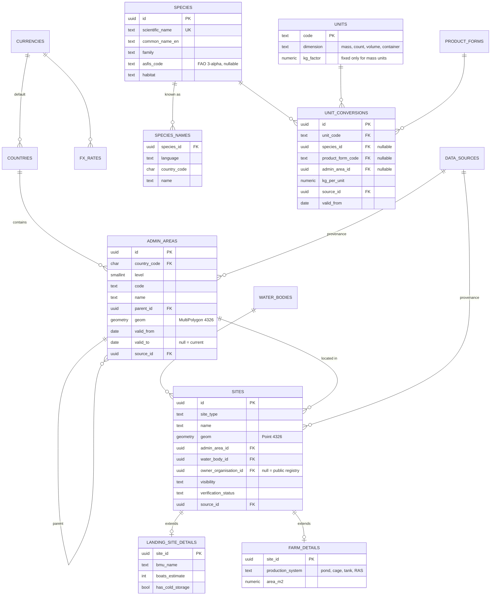
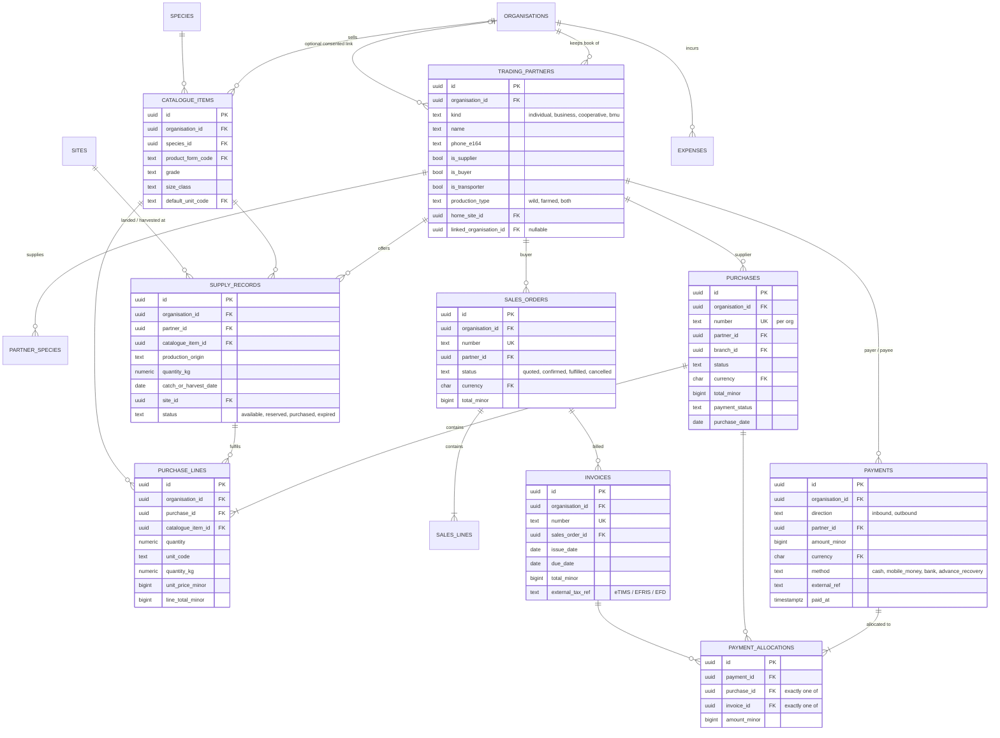
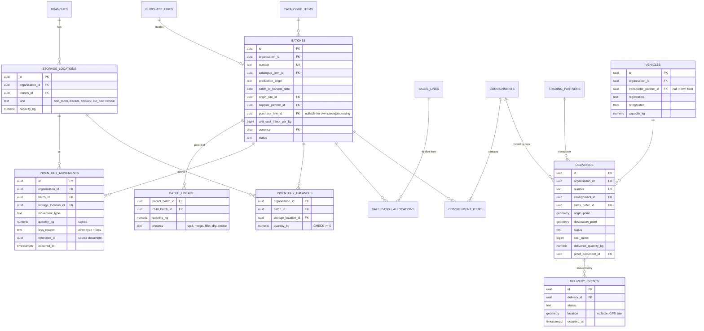
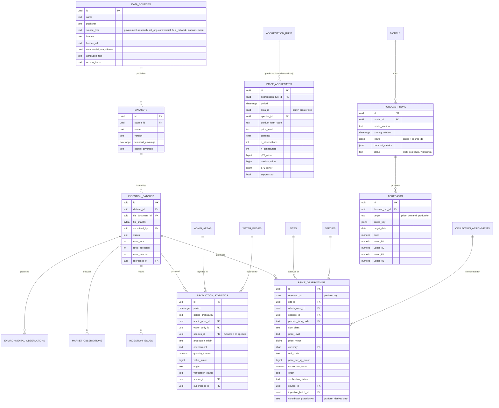
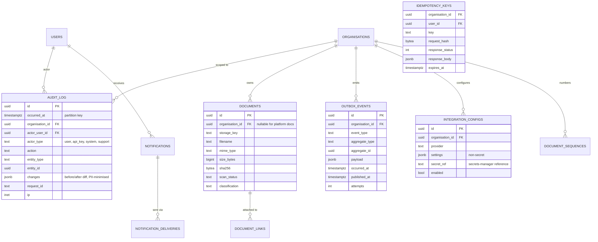

# Database Design — Blue Ecosystem Platform

> Status: **DRAFT v0.1 — Phase 1, awaiting review.** No migrations exist yet. This is a logical design; column lists show the important columns, not every audit column.
> Engine: PostgreSQL 17+ with PostGIS 3.5+. ORM/migrations: Drizzle (proposed, see DECISIONS.md ADR-005).

---

## 0. Implementation status

| Schema | Implemented (Phase 2.2) | Deferred to |
|---|---|---|
| `app` | `current_org_id()`, `current_user_id()`, `is_active_member()`, `ensure_audit_partitions()` | — |
| `identity` | users, user_credentials, sessions, otp_challenges | api_keys → auth increment (2.4) |
| `tenancy` | organisations, organisation_type_assignments, branches, memberships, roles, role_permissions, membership_roles, subscriptions, data_sharing_agreements | — |
| `ref` | currencies, countries, organisation_types, products, plans, permissions; **species, species_names, product_forms, units** (3.1) | admin areas, FX rates → Phase 3/4; global unit conversions deferred (ADR-017) |
| `system` | outbox_events (no RLS, documented exception), idempotency_keys, document_sequences | documents, notifications, integration configs → Phase 3 |
| `audit` | audit_log (monthly partitions + default, append-only) | — |
| `ops` | catalogue_items, catalogue_item_units (3.1); trading_partners, partner_species (3.2: `landing_site` is free text for now; `home_site_id` and `linked_organisation_id` not built yet) | supply, trading, inventory, logistics, finance → rest of Phase 3 |
| `geo`, `intel` | — | Phase 4 |

Source: `packages/database` (schema in `src/schema`, SQL in `migrations/`). Tests: `packages/database/test/tenant-isolation.test.ts`.

## 1. Design principles

1. **Ownership by schema.** Each Postgres schema is owned by one platform area. Modules only write their own tables.

   | Schema | Owner | Tenant-scoped? | Contents |
   |---|---|---|---|
   | `identity` | identity module | No (global users) | users, credentials, sessions, OTP challenges |
   | `tenancy` | tenancy + billing modules | Yes (per org) | organisations, branches, memberships, roles, subscriptions, data-sharing agreements, API keys |
   | `ref` | reference-data module | No (global, curated) | countries, currencies, FX rates, admin areas, species, product forms, units, conversions |
   | `geo` | geo module | Mixed (public registry + org-private rows) | water bodies, sites (landing sites, markets, farms…), fishing grounds, layers |
   | `ops` | SamakiOS modules | **Yes — RLS on every table** | partners, supply, trading, inventory, logistics, finance |
   | `intel` | BlueData modules | No (entitlement-controlled) | sources, datasets, ingestion, observations, aggregates, forecasts |
   | `audit` | audit module | Yes (org_id column, RLS for tenant reads) | audit log |
   | `system` | kernel | Mixed | outbox, idempotency keys, documents, notifications, document sequences, integration configs |

2. **Identifiers.** `uuid` primary keys generated as **UUIDv7** (time-ordered → good B-tree locality; client-generatable for offline). Human-facing document numbers (`PO-2026-000123`) come from `system.document_sequences` per org/type/year.
3. **Tenant keys.** Every `ops` table has `organisation_id uuid NOT NULL`. Child tables use **composite FKs** `(organisation_id, parent_id) → parent(organisation_id, id)`, backed by a `UNIQUE (organisation_id, id)` on the parent. This makes cross-tenant references impossible even if application code is wrong.
4. **Money.** `amount_minor bigint` + `currency char(3)` (ISO 4217) referencing `ref.currencies`, which stores `minor_units` (KES 2, TZS 2, UGX 0, RWF 0). Never floats. Totals are stored on documents and verified by tests against their lines.
5. **Quantities.** Every quantity row stores `quantity numeric(14,3)` + `unit_code` as entered **and** `quantity_kg numeric(14,3)` with `conversion_factor numeric(12,6)` and `conversion_id` used. Count-based items (pieces) keep `piece_count` as well.
6. **Time.** `timestamptz` in UTC everywhere. Business dates that are calendar dates (catch date, invoice date) are `date`, interpreted in the org's timezone (`tenancy.organisations.timezone`).
7. **Mutability.**
   - Master data (partners, items, sites): updatable, with `version int` for optimistic locking and `archived_at` instead of delete.
   - Financial and stock documents: editable only in `draft`; once `confirmed` they are **immutable**; corrections are cancellations/reversals that create compensating rows.
   - Ledgers (inventory movements, payments, audit log): **append-only** (runtime role has no UPDATE/DELETE privilege).
8. **Standard columns** on mutable tables: `created_at`, `created_by`, `updated_at`, `updated_by`, `version`. Not repeated below.
9. **Provenance** on every `intel` observation: `origin`, `verification_status`, `source_id`, `dataset_id`, `ingestion_batch_id`, `raw_row_ref`.
10. **Indexes** are listed where they are non-obvious. All FKs get an index. Composite indexes lead with `organisation_id` on tenant tables.

### 1.1 Enumerations (as Postgres enums or check-constrained text — decision in Phase 2; I recommend `text` + `CHECK` for easier evolution)

| Name | Values |
|---|---|
| `production_origin` | `wild_caught`, `farmed` |
| `environment` | `inland`, `marine`, `brackish` |
| `site_type` | `landing_site`, `market`, `processing_facility`, `cold_store`, `fish_farm`, `hatchery`, `feed_supplier`, `port`, `warehouse`, `office` |
| `doc_status` | `draft`, `confirmed`, `partially_fulfilled`, `fulfilled`, `cancelled` |
| `payment_status` | `unpaid`, `partially_paid`, `paid`, `overpaid` |
| `movement_type` | `receipt`, `sale_issue`, `transfer_out`, `transfer_in`, `processing_in`, `processing_out`, `adjustment_gain`, `adjustment_loss`, `loss` |
| `loss_reason` | `spoilage`, `rejection`, `damage`, `theft`, `shrinkage_drying`, `weighing_variance`, `other` |
| `data_origin` | `official_statistic`, `external_dataset`, `field_collection`, `user_submission`, `platform_derived`, `estimate` |
| `verification_status` | `unverified`, `pending_review`, `verified`, `rejected`, `disputed`, `superseded` |
| `price_level` | `landing`, `farm_gate`, `wholesale`, `retail`, `export_fob` |

---

## 2. Entity-relationship diagrams

Split by domain for readability. Cross-domain links are shown by repeating the referenced entity with only its key.

### 2.1 Identity, tenancy, subscriptions

### 2.2 Reference data and geography

### 2.3 SamakiOS — partners, supply, trading, finance

### 2.4 SamakiOS — inventory and logistics

### 2.5 BlueData — intelligence

### 2.6 System

---

## 3. Table notes by domain

### 3.1 Identity (`identity`)

- `users`: `CHECK (email IS NOT NULL OR phone_e164 IS NOT NULL)`; unique partial indexes on `lower(email)` and `phone_e164` where not null. A user record never contains organisation data.
- `user_credentials (user_id, type, secret_hash, created_at)` — `type` in `password`, `totp`, `external_oidc` (future SSO).
- `sessions`: store only `token_hash`. Index `(user_id) WHERE revoked_at IS NULL`. Expired sessions purged by a job.
- `otp_challenges (id, channel, destination_hash, code_hash, purpose, attempts, expires_at, consumed_at)` — destination stored hashed; plaintext phone lives only on the user.

### 3.2 Tenancy (`tenancy`)

- `organisations`: country and default currency are FKs to reference data, never enums — adding Ethiopia is a data change.
- `organisation_types` (reference): `fisher`, `cooperative`, `bmu`, `trader_aggregator`, `wholesaler`, `processor`, `exporter`, `fish_farm`, `distributor`, `cold_storage_operator`, `association`, `government_agency`, `research_institution`, `ngo`, `investor`. Many-to-many because a business is often trader + processor.
- `memberships`: `UNIQUE (organisation_id, user_id)`.
- `permissions` table is **seeded from code** at deploy; FK from `role_permissions` guarantees roles only reference existing keys.
- `subscriptions`: `EXCLUDE USING gist (organisation_id WITH =, plan_product WITH =, tstzrange(starts_at, ends_at) WITH &&)` prevents two overlapping active subscriptions for the same product.
- `data_sharing_agreements`: `scope` in `price_contribution`, `volume_contribution`, `site_publication`, …; `granularity` in `daily_site`, `weekly_admin_area`, …. History is preserved; revocation sets `revoked_at`.
- `api_keys (id, organisation_id, name, prefix UNIQUE, secret_hash, scopes text[], expires_at, last_used_at, revoked_at, created_by)`.

### 3.3 Reference (`ref`)

- `currencies (code PK, minor_units, name)`; `fx_rates (base, quote, rate numeric(20,10), as_of date, source_id, PK(base, quote, as_of, source_id))`.
- `admin_areas`: `EXCLUDE USING gist (country_code WITH =, level WITH =, code WITH =, daterange(valid_from, valid_to) WITH &&)` — no two versions of the same area overlap in time. GiST on `geom`. Simplified geometry copies (`geom_simplified`) for map rendering.
- `species`: seeded initially with the commercially important Lake Victoria species (Nile perch, Nile tilapia, *Rastrineobola argentea*, African catfish, lungfish, Haplochromines) plus key aquaculture species; extended by data stewards. `species_names` indexed with `pg_trgm` for fuzzy search across languages.
- `product_forms`: `fresh_whole`, `fresh_gutted`, `fillet_fresh`, `fillet_frozen`, `sun_dried`, `smoked`, `fried`, `salted`, `fish_maw`, `frames_offcuts`, `fish_meal`, `live_fingerlings`.
- `units`: mass units (`kg`, `g`, `t`) with fixed `kg_factor`; count/container units (`piece`, `basin`, `tin`, `crate`, `bag`, `bucket`) have **no fixed factor** — they rely on `unit_conversions`, which carry provenance and can vary by species, form and region. If no conversion exists, the API requires the user to also enter a weighed kg value.

### 3.4 Geography (`geo`)

- `sites` is the single registry for all points of interest. Org-private sites (`owner_organisation_id` set, `visibility = private`) are RLS-protected; public registry sites are readable by all authenticated users. A trader can propose a private site for publication → review queue → becomes public with provenance.
- `admin_area_id` on sites is computed by point-in-polygon at write time against the **current** boundary version.
- `water_bodies (id, name, kind, geom, countries char(2)[])`.
- `fishing_grounds (id, name, water_body_id, geom Polygon, sensitivity)` — optional, never public at fine resolution.
- `layers (id, name, source_id, licence, geometry_type, storage 'postgis'|'pmtiles', storage_ref, bbox)`.

### 3.5 SamakiOS operational (`ops`) — all RLS

**Partners.** One `trading_partners` table instead of separate `suppliers` and `buyers`: in this value chain the same party often buys and sells (a trader supplies a processor and buys from them by-products), and transporters are also partners. Role flags plus `partner_species` and `production_type` give the required categorisation. `UNIQUE (organisation_id, phone_e164) WHERE phone_e164 IS NOT NULL` helps de-duplicate within a tenant. Supplier performance (volumes, rejection rate, price vs market, on-time) is **derived** in reporting, not stored.

**Supply records** cover "record fish availability" for wild and farmed fish. `CHECK` constraints: farmed ⇒ site is a `fish_farm` (validated in service; DB check via trigger), wild ⇒ landing site. A supply record can be consumed by one or more purchase lines (partial purchase of an offer).

**Catch and harvest records.** For fisher/cooperative/BMU and farm tenants:
- `catch_records (id, organisation_id, member_partner_id, landing_site_id, fishing_ground_id, gear_type, vessel_ref, landed_at)` + `catch_record_lines (catalogue_item_id, quantity_kg, piece_count)`.
- `production_units (pond/cage/tank)`, `production_cycles (stocking date, species, fingerlings stocked, feed used, mortality)`, `harvest_records (cycle, harvested_at, quantity_kg, mean weight)`.
- In the MVP these are **schema-ready but UI-light**; the trader workflow is the priority. Catch/harvest records can generate supply records.

**Trading.**
- `purchases` support both a *planned* PO and the dominant landing-site reality — a **direct spot purchase** (draft → confirmed in one step, goods received immediately). Confirming a purchase in one transaction: creates batches, inventory movements (`receipt`), updates balances, sets payment status, writes audit + outbox.
- `sales_orders` include quotations (`status = quoted`) instead of a separate quotations table; a quote converts in place. If quotes later need versioning we split them out.
- `invoices` are issued from sales orders; immutable after issue; numbering per org per year from `document_sequences` (gap-free sequences use a row lock on the sequence row — acceptable at our write rates).
- "Transactions" is **not a table** — it is a reporting view over purchases, sales, invoices, payments and expenses. A separate table would duplicate facts and drift.
- `payments` + `payment_allocations` support partial payments, one payment covering many documents, and **advances** to fishermen (unallocated outbound payments recovered later against purchases). `CHECK (num_nonnulls(purchase_id, invoice_id) = 1)` and allocations may not exceed the payment amount (enforced in service, verified by test; optionally a deferred constraint trigger).
- Outstanding balances = document totals − allocations; materialised per partner in `partner_balances` maintained in the same transaction for fast dashboards (and reconciled nightly).

**Margins.** Gross margin per sale line = revenue − Σ(allocated batch kg × batch cost per kg). Batch cost per kg = purchase cost + landed costs (transport, ice, levies) allocated to the batch via `batch_cost_allocations`. Specific-identification costing by batch is natural for fish and avoids FIFO/AVCO debates for the MVP.

**Inventory.**
- `batches` are the unit of stock, cost and (later) traceability.
- `inventory_movements` is an **append-only ledger**; `inventory_balances` is maintained in the same transaction with `SELECT … FOR UPDATE` on the balance row and `CHECK (quantity_kg >= 0)` — overselling is impossible at the database level.
- Loss/spoilage/rejection is a `movement_type = loss` with `loss_reason` (and optional `loss_details` row for photos/notes/inspector). No separate "loss records" table holding duplicate quantities; loss reports are queries over movements.
- Processing (whole → fillet + frames) uses `processing_out` from parent batches, `processing_in` to child batches and `batch_lineage` rows; yield % is derived. Full processing-run management is post-MVP.
- Index: `inventory_movements (organisation_id, batch_id, occurred_at)`, `(organisation_id, occurred_at)`.

**Logistics.**
- Transport providers are `trading_partners` with `is_transporter`; `vehicles` belong to the org (own fleet) or a transporter.
- `consignments` group batches for shipment; `deliveries` are the transport legs (a consignment may need a boat leg and a truck leg). Delivery confirmation stores receiver name, delivered kg (variance vs dispatched becomes a loss movement if confirmed), and a proof document.
- `delivery_events` give status history now and accept GPS points later; when GPS arrives it moves to a partitioned `delivery_tracks` table.

**Finance.**
- `expenses (id, organisation_id, category, amount_minor, currency, incurred_on, partner_id, batch_id, delivery_id, document_id)` with categories (transport, ice, labour, levies/cess, storage, packaging, rent, other).
- Revenue, purchase cost, P&L, cash-flow summaries are **queries/views** over documents and payments — not a general ledger. A chart-of-accounts export (for the customer's accountant) is a later feature.

### 3.6 Intelligence (`intel`)

- `price_observations`, `market_observations`, `environmental_observations`: **range-partitioned by month** on the observation date. Indexes: `(species_id, product_form_code, observed_on)`, `(site_id, observed_on)`, `(admin_area_id, observed_on)`, BRIN on `observed_on` for large partitions.
- Duplicate protection: `UNIQUE (source_id, site_id, species_id, product_form_code, price_level, observed_on, raw_row_ref)` for external sources.
- `production_statistics`: revisions never overwrite — a revised figure is a new row with `supersedes_id`, the old one becomes `superseded`. A view `production_statistics_current` exposes the latest.
- `market_observations (indicator_code, value, unit, site_id, observed_on, …)` holds non-price indicators: supply level, number of boats landed, buyer counts, stock-outs. Indicators are defined in `indicator_definitions`.
- `environmental_observations (parameter_code, value, unit, geom/site_id, observed_at, method)`: water temperature, dissolved oxygen, pH, ammonia, turbidity, chlorophyll; from farms (user-submitted), research partners or satellite products.
- `collection_assignments (collector_user_id, site_id, schedule, indicators)` supports a field-enumerator network.
- `price_aggregates` and similar aggregate tables carry `n_observations`, `n_contributors`, `suppressed`; the API never returns suppressed cells' values.
- `models`, `forecast_runs`, `forecasts`, `anomalies`: AI output only; every row traceable to run, model version, inputs and back-test metrics.

### 3.7 System (`system`, `audit`)

- `audit.audit_log`: monthly partitions; app role has INSERT + SELECT only; retention by detaching old partitions to cold storage per policy.
- `system.outbox_events`: index `(published_at) WHERE published_at IS NULL`; claimed with `FOR UPDATE SKIP LOCKED`; published rows purged after 7 days.
- `system.idempotency_keys`: `PRIMARY KEY (organisation_id, user_id, key)`; stores request hash and response; expires after 7 days (long enough for offline devices to resync).
- `system.document_sequences (organisation_id, document_type, period, next_value)`.
- `system.documents` + `document_links (document_id, entity_type, entity_id)`; files in object storage, DB holds metadata and checksum.
- `system.notifications` + `notification_deliveries (channel in_app/sms/email/push, status, provider_message_id, cost_minor)`.

---

## 4. Transaction boundaries (examples)

| Use case | Single transaction contains |
|---|---|
| Confirm purchase | purchase status → batches → inventory movements + balances → partner balance → (optional) payment + allocation → audit → outbox |
| Record sale fulfilment | sale status → batch allocations → movements + balances (fails if insufficient stock) → partner balance → audit → outbox |
| Record loss | movement + balance → audit → outbox (`inventory.loss_recorded`) |
| Approve ingestion batch | staged rows → observations; batch status; audit |
| Revoke data sharing | agreement `revoked_at`; audit; outbox (`sharing.revoked`) — stops future contributions |

External calls (SMS, file scanning, tax APIs) **never** happen inside a DB transaction; they are triggered from outbox events.

---

## 5. Row-Level Security catalogue

| Tables | Policy |
|---|---|
| `ops.*`, `tenancy.branches`, `tenancy.roles`, `tenancy.subscriptions`, `tenancy.data_sharing_agreements`, `tenancy.api_keys`, `system.documents` (org-owned), `system.idempotency_keys` | `organisation_id = current_setting('app.org_id', true)::uuid` |
| `geo.sites` | `visibility = 'public' OR owner_organisation_id = current_org` (read); write only own private rows or via steward role |
| `audit.audit_log` | tenant reads own org's rows; platform roles via separate role |
| `intel.*` | No tenant RLS; access controlled by entitlements at API layer; runtime role has SELECT; writes only via ingestion/pipeline roles |
| `identity.*` | Not exposed to tenant queries; accessed only by identity module |

CI check: any table in `ops` without `relrowsecurity AND relforcerowsecurity` fails the build.

---

## 6. Migration strategy

- SQL-first migrations generated by Drizzle Kit and **reviewed by hand**; RLS policies, partitions, exclusion constraints and triggers written in SQL in the same migration files.
- Forward-only in production; each migration must be backward-compatible with the previous app version (expand → backfill → contract).
- Partition creation automated (scheduled job creates next 3 months; or `pg_partman` if the managed provider supports it).
- Seed data split into: **reference seeds** (currencies, countries, units, species, product forms, permissions — run in all environments) and **demo seeds** (synthetic orgs and transactions — never in production).

---

## 7. Open database questions

1. `text + CHECK` vs Postgres enums for status fields (recommend text + CHECK).
2. Do we need gap-free invoice numbering per country (tax rules) or is monotonic-with-gaps acceptable? Affects sequence design.
3. Is H3 indexing available on the chosen managed Postgres? If not, compute in app.
4. Partitioning of `ops.inventory_movements` — not needed at MVP volumes; revisit at ~50M rows.
5. Retention periods for each data class (legal input required).
