# Development Roadmap

> Assumes 2–3 full-stack engineers + founder. Durations are estimates to be recalibrated after Phase 2. Each phase ends with the review package defined in the project brief (implemented, files, decisions, commands, tests, known issues, remaining tasks, next step).

## Recommended adjustments to the phase plan

1. **Deploy continuously from Phase 2.** Staging exists from the end of Phase 2 and every phase deploys to it. Phase 7 becomes *production hardening*, not first deployment.
2. **Start price data collection early.** Forecasting (Phase 6) needs ≥ 24 months of history. Begin structured field price collection (CSV template + simple submission form) during Phase 3, even before the BlueData UI exists. Every month of delay is a month of missing history.
3. **Shared identity is Phase 2, not Phase 5.** The platform is built shared from the start; Phase 5 delivers the *data-sharing pipeline and cross-product UX*, not account unification.
4. **Pilot SamakiOS after Phase 3** with 3–5 real businesses at one or two landing sites, on a production-grade (but small) environment, before investing deeply in Phase 4.

## Phases

```mermaid
gantt
    title Indicative timeline (weeks from approval)
    dateFormat  X
    axisFormat  %s
    section Foundation
    Phase 1 Architecture review         :done, p1, 0, 1
    Phase 2 Foundation                  :p2, 1, 5
    section SamakiOS
    Phase 3 SamakiOS MVP                :p3, 5, 17
    SamakiOS pilot                      :pilot, 17, 23
    section BlueData
    Field price collection (CSV)        :col, 10, 60
    Phase 4 BlueData MVP                :p4, 17, 27
    section Platform
    Phase 5 Integration                 :p5, 27, 32
    Phase 7 Production hardening        :p7, 32, 36
    Phase 6 AI (data-gated)             :p6, 60, 72
```

### Phase 1 — Technical discovery & architecture (current)
Deliverables: ARCHITECTURE, DATABASE, API, DECISIONS, ROADMAP, STATUS. **Exit:** founder approves ADR-001…009 and answers blocking questions.

### Phase 2 — Project foundation (~4 weeks) — ✅ complete (2026-11-03); staging written and validated, apply pending AWS account, domain and repository
- Monorepo (pnpm, Turborepo), lint/format, TS strict, dependency-boundary rules.
- Docker compose: PostGIS, Valkey, Mailpit (local S3 emulator chosen in Phase 3 — MinIO no longer publishes community images).
- `packages/database`: schemas `identity`, `tenancy`, `ref`, `geo`, `system`, `audit`; RLS framework; reference seeds.
- API kernel: config validation, pino logging, OTel, error model (problem+json), Zod pipes, idempotency middleware, tenant transaction context, audit service, outbox relay.
- Auth spike (Better Auth vs in-house) → implement phone OTP + password, sessions, `/me`, org registration, memberships, system roles, permission guards.
- OpenAPI generation + `api-client`.
- `@blue/ui` foundations: tokens, typography, layout shell, table, form, dialog, map wrapper; both web apps with login and org switcher.
- Testing: Vitest, Testcontainers integration tests incl. **cross-tenant isolation suite**, Playwright smoke test.
- CI (GitHub Actions) + staging environment via IaC.
**Exit:** a user can sign up by phone, create an org, invite a member, and see an empty dashboard in both apps on staging; all tests green.

### Phase 3 — SamakiOS MVP (~12 weeks) — in progress (3.1 done 2026-11-03)
Order chosen to deliver one end-to-end workflow early (purchase → stock → sale → payment → report):
1. Species/catalogue items, units & conversions UI.
2. Trading partners (suppliers/buyers/transporters).
3. Supply records (wild/farmed).
4. Purchases incl. spot purchase, batches, receipts → inventory.
5. Inventory: balances, transfers, adjustments, losses.
6. Sales orders/quotes, fulfilment from batches, invoices.
7. Payments, allocations, advances; outstanding balances.
8. Expenses; margin per sale and per batch.
9. Dashboard + core reports + CSV/XLSX exports.
10. Offline PWA capture for spot purchases.
11. Basic deliveries (assign, dispatch, confirm) if time permits; otherwise early Phase 4.
**Exit:** pilot businesses run daily operations for 2 weeks without spreadsheets; reconciliation tests pass.

### Phase 4 — BlueData Africa MVP (~10 weeks)
Geo infrastructure (admin areas import with licence metadata, water bodies, sites registry), MapLibre map, landing-site & facility mapping, data sources/datasets, CSV ingestion pipeline with validation & review queue, manual submissions, production statistics, price observations & aggregates, historical price charts, geographic comparisons (choropleths), attribution everywhere, basic exports.
**Exit:** steward can load a dataset end-to-end with provenance; users can explore prices and production on map and charts with sources shown.

### Phase 5 — Platform integration (~5 weeks)
Data-sharing agreement UX & legal terms, outbox → contribution pipeline, k-anonymity aggregation, cross-product navigation, SamakiOS "market context" widgets fed by BlueData (e.g. your purchase price vs market median), unified notifications.
**Exit:** consented SamakiOS transactions appear only as suppressed-or-aggregated intelligence; isolation tests extended to the pipeline.

### Phase 6 — AI & advanced analytics (data-gated)
Starts only when readiness gates are met (series density/length). Python service, baselines, back-testing, price/demand/production forecasts with intervals, anomaly detection, opportunity analysis, grounded natural-language analytics.

### Phase 7 — Production hardening (~4 weeks, plus continuous)
External penetration test, DPIA finalisation and regulator registrations, Multi-AZ, backup restore drill, load tests (k6), runbooks, on-call, user documentation and onboarding flows.
